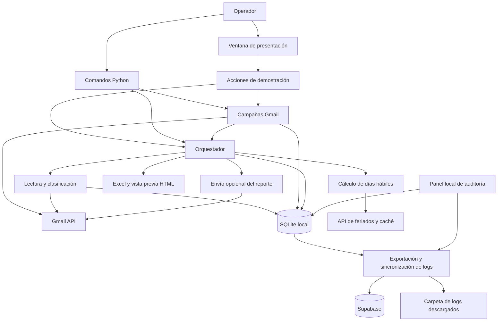

# Funcionamiento y estructura del proyecto RPA de gestión de correos

Documento de referencia para comprender, presentar y mantener el proyecto EP3. Actualizado el 23 de noviembre de 2026; conserva identificadas las evidencias históricas de campañas reales.

Actualización funcional del 22 de noviembre: la interfaz ahora tiene siete secciones,
presets y escenarios configurables. La [guía de presentación](DEMO_PRESENTACION.md)
describe las cantidades, la semilla, las pruebas negativas locales, los reportes de
escenarios y la confirmación por tanda. Las cifras de campañas reales citadas más
abajo siguen siendo evidencia histórica del 20 de noviembre.

La revisión del 23/11 verifica 127 pruebas, escenarios locales, navegación con mensajes largos y conexiones reales de lectura. Los controles de Inicio quedan separados del estado desplazable, las barras de acciones se reorganizan por ancho y las pestañas permiten desplazar su contenido. Consulta [la validación actual](VALIDACION_2026-11-23.md) y [la guía de uso paso a paso](../COMO_UTILIZAR.md).

El proyecto automatiza la lectura de metadatos de correo, su clasificación en seis categorías, el cálculo de plazos en días hábiles de Chile y la generación de un reporte Excel. Conserva el estado del trabajo en SQLite, registra tiempos y errores, sincroniza auditoría con Supabase y permite demostrar el proceso desde una ventana local.

Incluye un generador de correos de prueba para comprobar el flujo con Gmail real. **Preparar mensajes, enviarlos, recibirlos y analizarlos son etapas diferentes:** cada una tiene su propia evidencia y puede completarse parcialmente.

## Objetivo y alcance

El problema que resuelve es el trabajo repetitivo de revisar asuntos, asignar categorías, calcular fechas de atención y consolidar resultados. El operador elige el modo de ejecución, autoriza las cuentas cuando corresponde y revisa los casos que el programa no puede resolver con certeza.

La aplicación funciona localmente en Windows. La automatización principal usa APIs y archivos: Gmail API para correo, una API pública para feriados, openpyxl para Excel y Supabase para el historial remoto. Existe soporte adicional de Microsoft Graph y Office COM, conservado como compatibilidad.

La clasificación no utiliza inteligencia artificial ni consume tokens de ChatGPT. Aplica reglas de palabras configurables. El programa tampoco responde las solicitudes recibidas, interpreta los cuerpos, descarga adjuntos del buzón ni determina si una petición de negocio fue resuelta. El plazo calculado es una fecha interna de atención, no una garantía legal o contractual.

## Modos de uso

| Modo | Entrada | Qué produce | Efectos sobre el correo |
| --- | --- | --- | --- |
| Simulación de presentación | Mensajes sintéticos locales | Clasificación, Excel y logs en carpetas aisladas | No usa Gmail; esta simulación también desactiva Supabase |
| Preparación de campaña | Cantidad, remitente y destinatario | Manifiesto de mensajes y base de seguimiento | No envía |
| Envío de campaña | Una campaña preparada | Intento y estado persistente de cada mensaje | Envía realmente solo con ejecución explícita |
| Análisis de campaña | Correos del receptor que pertenecen al lote | Recepción comprobada, clasificación y resultados acumulados | Solo lectura |
| Envío de reporte | Excel validado y destinatario permitido | Un correo consolidado con adjunto | Es una operación separada del envío de mensajes de prueba |

`SOURCE` selecciona el origen de lectura: `FIXTURE`, `GMAIL` o `GRAPH`. `MAIL_MODE` controla el envío del **reporte**: `DRY_RUN` prepara archivos y `SEND` permite intentar el envío si se cumplen las validaciones. Los mensajes de prueba Gmail se autorizan por separado mediante `--execute` o la confirmación de la ventana; no basta con interpretar `MAIL_MODE` para saber si una campaña enviará correos.

La ventana permite simulaciones de 1 a 1.000 mensajes. El generador de campañas reales permite de 1 a 500 por campaña. Preparar dos campañas de 500 no aumenta la cuota de la cuenta remitente ni garantiza que ambas se puedan enviar el mismo día.

## Arquitectura general



SQLite es la fuente local del estado operativo. Supabase recibe registros de auditoría; no sustituye la base que conserva mensajes, cursores y estados de envío. Por eso una interrupción de Supabase no debe provocar que se vuelvan a enviar correos.

La ventana de presentación y el panel web tienen propósitos distintos. La primera ejecuta demostraciones y campañas. El panel permite consultar eventos, exportarlos, sincronizarlos y gestionar su retención.

## Estructura de carpetas

```text
RPA/
  Abrir_Demo.cmd             Lanzador de la ventana de presentación
  demo_presentacion.py      Interfaz de escritorio con Tkinter
  main.py                   Comandos del robot y de los logs
  autenticar_gmail.py        Autorización OAuth por rol
  .env                      Configuración privada del equipo
  .env.example              Referencia de variables
  rpa/                      Lógica de la aplicación
  config/
    reglas.json             Categorías, prioridades y palabras clave
    google/                 Credenciales OAuth y tokens privados
  migrations/               Esquema y actualizaciones de SQLite
  supabase/migrations/      Esquema remoto de auditoría
  templates/                Plantilla Excel y correo HTML
  fixtures/                 Datos auxiliares de prueba
  scripts/                  Instalación, campañas, diagnósticos y entregables
  tests/                    Pruebas automatizadas
  runtime/                  Estado privado, caché, campañas y logs
  output/                   Reportes y resultados por ejecución
  docs/                     Guías, diagramas y evidencia
  dist/                     Entregables generados para distribución
```

`runtime/`, `output/`, `.env` y los tokens contienen datos del equipo o de sus ejecuciones. No forman parte del código público. La generación del ZIP usa una selección explícita de archivos y excluye el estado privado.

## Responsabilidad de los módulos

| Archivo o grupo | Responsabilidad |
| --- | --- |
| `rpa/config.py` | Carga `.env`, aplica variables del proceso, valida modos, cuentas, fechas y límites; calcula firmas de configuración |
| `rpa/demo_actions.py` | Conecta los botones con simulación, preparación, envío, análisis y consolidación |
| `rpa/scenarios.py` | Valida cantidades y configuraciones, define presets y genera escenarios reproducibles |
| `rpa/scenario_runner.py` | Ejecuta escenarios locales aislados y fallos técnicos mediante transportes simulados |
| `rpa/scenario_reports.py` | Compara resultados, separa contadores y exporta CSV, JSON y una copia Excel de pruebas |
| `rpa/orchestrator.py` | Coordina una ejecución de lectura, clasificación, calendario, Excel, reporte y auditoría |
| `rpa/gmail_auth.py` | Autoriza cuentas por rol, guarda tokens protegidos y los refresca |
| `rpa/gmail.py` | Lee metadatos Gmail, pagina resultados y consulta cambios incrementales |
| `rpa/mail_read.py` | Contrato de páginas y lectores sintético y Microsoft Graph |
| `rpa/gmail_campaign.py` | Genera campañas, envía cada mensaje con seguimiento y compara recepción con lo esperado |
| `rpa/classify.py` | Normaliza el asunto y aplica las reglas de categoría |
| `rpa/holidays.py` | Valida feriados, administra la caché anual y calcula plazos |
| `rpa/store.py` | Gestiona SQLite, deduplicación, cursores y copias de datos por ejecución |
| `rpa/excel.py` | Genera y verifica el Excel; contempla integración opcional con Excel de escritorio |
| `rpa/campaign_report.py` | Consolida una campaña completa aunque se haya analizado en varias ejecuciones |
| `rpa/mail_send.py` | Prepara el correo del reporte y conserva su estado antes de enviarlo |
| `rpa/runtime.py`, `rpa/http.py` | Bloqueos, tiempos máximos, eventos y reintentos de consultas seguras |
| `rpa/cloud_logs.py`, `rpa/log_files.py` | Cola de sincronización, exportación local y limpieza de copias de logs |
| `rpa/retention.py`, `rpa/maintenance.py` | Selección, respaldo y eliminación controlada de archivos o eventos elegibles |
| `rpa/panel.py` | Panel FastAPI local de auditoría y mantenimiento |

## Reglas de clasificación

Las reglas están en [config/reglas.json](../config/reglas.json), versión `1.0.0`. Cada mensaje recibe una sola categoría. Un número de prioridad menor se evalúa antes.

| Prioridad | Categoría | Palabras clave |
| --- | --- | --- |
| 10 | Urgente | urgente, urgencia, critico, inmediato |
| 20 | Reclamo | reclamo, queja, incumplimiento |
| 30 | Solicitud | solicitud, solicito, requiero |
| 40 | Consulta | consulta, pregunta, duda |
| 50 | Información | informacion, informativo, aviso, comunicado |
| Al final | Otros | Se usa cuando ninguna regla coincide |

El clasificador elimina las diferencias entre mayúsculas y minúsculas y normaliza los acentos. Así, `INFORMACIÓN` puede coincidir con `informacion`. Las búsquedas usan límites de palabra y las palabras configuradas se tratan como texto literal, no como expresiones ejecutables.

Por ejemplo, `Solicitud urgente de acceso` se clasifica como **Urgente**, porque esa regla se evalúa antes que Solicitud. `Pregunta por el horario` corresponde a Consulta. `Saludos del equipo` corresponde a Otros. `Solicitudes del equipo` no coincide por sí solo con la palabra exacta `solicitud`: el sistema no aplica sinónimos ni análisis gramatical.

Solo se usa el asunto. La prioridad decide la categoría cuando hay varias coincidencias; **no cambia el plazo ni establece un orden de envío**. Cada clasificación guarda la categoría, el identificador de regla y su versión. Editar las reglas no reclasifica automáticamente todo el historial ya procesado.

## Reglas de fechas y días hábiles

El plazo predeterminado es de **tres días hábiles**, configurable mediante `BUSINESS_DAYS` entre 1 y 30. Se aplica a todas las categorías.

El algoritmo convierte la recepción a `America/Santiago`, toma su fecha local y comienza a contar desde el día siguiente. Acepta lunes a viernes y excluye feriados con `global=true` y tipo `Public` del calendario de Chile. Si atraviesa un cambio de año, obtiene también el calendario del año siguiente.

Ejemplo: si un correo llega un viernes y no hay feriados en los días siguientes, tres días hábiles corresponden a lunes, martes y miércoles; el plazo será el miércoles. Se calcula una fecha, no una hora exacta de vencimiento.

En modo `LIVE`, el módulo consulta Nager.Date y puede reutilizar una caché validada, cuya vigencia predeterminada es de 168 horas. En modo `FIXTURE`, usa cuatro feriados sintéticos por año para pruebas; ese calendario no representa todos los feriados reales. Si no consigue un calendario válido, deja el plazo sin valor y bloquea el envío del reporte incompleto. No incluye feriados regionales.

## Flujo completo de procesamiento

1. **Cargar configuración.** El programa toma como referencia la raíz del proyecto, lee `.env` y aplica las variables del proceso con precedencia. Valida fechas, origen, límites y condiciones de envío.
2. **Adquirir bloqueos.** El orquestador bloquea el perfil y el estado compartido para impedir que dos ejecuciones modifiquen ese mismo flujo a la vez. Una ejecución pendiente puede exigir reanudación antes de iniciar otra.
3. **Crear o recuperar la ejecución.** Asigna un UUID y registra inicio, origen y firma de configuración. Una reanudación debe conservar la configuración relevante de la ejecución original.
4. **Autorizar la lectura.** Para Gmail, carga el token del receptor y lo refresca cuando corresponde. La operación normal no abre el navegador; una autorización nueva es explícita.
5. **Leer páginas de metadatos.** Aplica carpeta, período y, cuando existe, identificador de campaña. Excluye los asuntos de reportes `[RPA-EP3]` para que el robot no procese su propio reporte.
6. **Guardar datos y cursor juntos.** Cada página se confirma en una transacción SQLite. El cursor representa el punto desde el que se puede continuar. Si esa transacción falla, no se adelanta el cursor sin sus datos.
7. **Deduplicar y clasificar.** Compara el identificador del proveedor y la huella del contenido. Clasifica los mensajes pendientes y guarda una copia de los datos usados por esa ejecución.
8. **Calcular plazos.** Carga el calendario necesario y agrega fecha de atención y resultado del cálculo.
9. **Generar el Excel.** Usa la plantilla, escribe las cuatro hojas, verifica estructura y cantidad de filas y calcula el hash del archivo.
10. **Preparar el reporte.** Genera una vista previa HTML y el manifiesto del adjunto. En `DRY_RUN` termina sin enviar ese correo; en `SEND` aplica las validaciones y registra el intento antes de llamar al proveedor.
11. **Cerrar la ejecución.** Guarda resultado, métricas y error, si existe. Sin novedades puede finalizar como `NO_CHANGES` sin crear un nuevo reporte.
12. **Finalizar auditoría.** Exporta los logs, intenta sincronizarlos con Supabase y aplica la limpieza configurada. Un fallo de esta última etapa no habilita un reenvío del correo.

Una ejecución incremental procesa novedades y cambios. Su Excel no es necesariamente el inventario histórico completo del buzón. Para reunir todos los mensajes esperados de una campaña se utiliza el consolidado específico de campañas.

## Flujo de campañas Gmail

La preparación crea `runtime/campaigns/<id>/mensajes.json` y `campaign.sqlite3`. El manifiesto contiene los asuntos y cuerpos sintéticos, el destinatario, el remitente y la categoría esperada. Su hash permite detectar modificaciones posteriores. Los asuntos incluyen un identificador `RPA-TEST-<id>` y un número individual.

El envío comprueba que la campaña corresponde a las cuentas configuradas. Procesa mensajes de forma secuencial, registra el intento antes del POST y omite los que ya figuran como aceptados o recibidos. `--limit` limita los intentos de esa invocación; no implementa por sí solo un contador global de cuota diaria de Gmail.

El análisis consulta el receptor y relaciona los mensajes con el lote. Gmail puede sustituir `Message-ID`; por eso también se verifica el asunto único generado, que contiene campaña y secuencia, junto con el remitente seudonimizado. La deduplicación de lectura continúa utilizando el ID del proveedor, no únicamente el asunto.

`GMAIL_LABEL=ALL` es una opción local que incluye Spam y Papelera en la búsqueda; no se envía como una etiqueta real a Gmail. Requiere un identificador de campaña para delimitar los datos. La aplicación consulta esas carpetas sin mover correos ni marcarlos como leídos.

Se guardan `envio_resultado.json`, `analisis_resultado.json` y `analisis_acumulado.csv`. El análisis acumula lo recibido en distintas ejecuciones y compara cantidad, categorías y duplicados. Una campaña está completa cuando todos sus mensajes esperados se recibieron y clasificaron correctamente, sin duplicados, y la ejecución de lectura terminó correctamente.

El consolidado de campaña exige esa recepción completa y reutiliza el Excel ya generado cuando corresponde. Puede existir un Excel de una ejecución parcial mientras el consolidado total todavía no está disponible.

## Estados y significado de los resultados

### Estados de ejecución

| Estado | Significado |
| --- | --- |
| `RUNNING` | El proceso está trabajando |
| `COMPLETED` | Terminó el trabajo de esa ejecución; no significa necesariamente que toda una campaña haya llegado |
| `NO_CHANGES` | La consulta incremental no aportó novedades que deban procesarse |
| `PARTIAL` | Quedó trabajo pendiente por un error o límite; se conserva el avance |
| `REVIEW` | Se necesita revisar el resultado o intervenir antes de continuar |

### Estados de cada mensaje de prueba

| Estado | Significado |
| --- | --- |
| `PENDING` | Todavía no se intentó enviar |
| `IN_FLIGHT` | Se registró el intento y está en curso la llamada |
| `ACCEPTED` | Gmail respondió satisfactoriamente con un ID de mensaje |
| `RECEIVED` | El análisis encontró el mensaje correspondiente en el receptor |
| `DEFERRED` | Un rechazo recuperable exige esperar hasta una fecha antes de volver a intentar |
| `UNCERTAIN` | No se puede determinar si el envío tuvo efecto; no se repite automáticamente |
| `BLOCKED` | Un rechazo o agotamiento de intentos impide continuar automáticamente |

El correo del reporte tiene su propio registro en `sends`: `PREPARADO`, `EN_ENVIO`, `DRY_RUN`, `ACEPTADO`, `ENVIO_INCIERTO`, `PENDIENTE_CUOTA`, `ERROR` o `ENTREGA_CONFIRMADA`. No debe confundirse con la tabla de mensajes de prueba.

**Aceptación y entrega son diferentes.** Una respuesta satisfactoria del proveedor permite registrar aceptación. La recepción se demuestra mediante la consulta al buzón destinatario o, para el reporte, una reconciliación del operador respaldada por evidencia. El comando `main.py reconcile` corresponde al reporte, no a cualquier mensaje de campaña.

## Persistencia y prevención de duplicados

La base principal es `runtime/state.sqlite3`. Sus tablas principales son:

| Tabla | Qué conserva |
| --- | --- |
| `executions` | Inicio, fin, estado, firma y métricas de cada ejecución |
| `messages` | Metadatos, huella, clasificación e intentos por mensaje y origen/buzón |
| `run_messages` | Copia de los datos utilizados por una ejecución |
| `checkpoints` | Cursor y fase de lectura por alcance de consulta |
| `operations` | Intentos persistentes de operaciones HTTP pendientes |
| `events` y `event_context` | Eventos y contexto adicional: rol, lote, trabajo, HTTP y recuperación |
| `sends` | Estado y hash del reporte preparado o enviado |
| `log_outbox` | Cola local de registros que deben sincronizarse con Supabase |
| `log_files` y `log_metadata` | Copias exportadas, vencimientos e identidad de instalación |
| `cleanups` | Evidencia de operaciones de limpieza |

Cada campaña tiene además su propia base con `manifest` y `deliveries`, donde se registra el hash del manifiesto y el estado de sus secuencias.

La identidad de lectura incorpora el origen y el buzón. Si el mismo ID llega con la misma huella, se omite como ya conocido; si sus metadatos cambian, se actualiza y vuelve a quedar pendiente de clasificación. Una eliminación o salida del alcance puede marcarse como `REMOVED` localmente.

El contador de duplicados de ingestión puede reflejar mensajes conocidos que aparecieron otra vez en una consulta. Eso no equivale a haber enviado correos duplicados. El análisis de campaña tiene una comprobación separada de duplicados recibidos.

## Errores y reintentos acotados

Las consultas GET son repetibles: ante errores transitorios usan espera creciente y respetan `Retry-After`. El valor predeterminado es de tres intentos; el contador se guarda en SQLite. También existen límites de tiempo para cada petición, operación y ejecución. Al agotar un límite el proceso sale con un resultado persistente, en vez de reiniciar un bucle.

Los POST de correo tienen un tratamiento distinto porque repetirlos podría enviar dos mensajes. Un timeout, una respuesta ambigua o una interrupción entre la llamada y el registro deja el envío incierto. En campañas, los HTTP 429 también requieren revisión; ciertos rechazos explícitos de cuota o frecuencia permiten aplazar el intento, con un máximo de tres intentos por mensaje.

En Supabase se pueden repetir escrituras mediante **upsert**: insertar o actualizar usando el mismo ID. La cola impone hasta tres intentos persistentes por registro, y por defecto una invocación trabaja como máximo cinco lotes de 100 dentro de 30 segundos. Una falla detiene esa invocación y conserva el estado para otra ejecución; reabrir la aplicación no borra el contador.

Reanudar el robot tampoco reinicia su tiempo activo acumulado. Si ese presupuesto ya se agotó, hace falta una recuperación técnica que conserve evidencia y estado. Borrar la base o marcar un envío incierto como pendiente sin verificarlo destruiría las garantías de recuperación.

## Reportes generados

Los archivos de una ejecución se guardan en `output/<execution_id>/`:

| Archivo | Uso |
| --- | --- |
| `reporte.xlsx` | Resumen y detalle de los mensajes procesados |
| `correo_reporte.html` | Vista previa del correo consolidado |
| `adjunto_manifest.json` | Tamaño, hash y ejecución asociada al adjunto |
| `resultado.json` | Estado, métricas y resultados de la ejecución |

El Excel contiene **Resumen**, con cantidades por categoría, total y gráfico; **Correos**, con identificador seudónimo, remitente seudonimizado, asunto oculto, recepción, clasificación y plazo; **Referencia_API**, con feriados y procedencia; y **Ejecuciones**, con identificación, tiempos, origen y estado de la comprobación de escritorio.

La plantilla original se conserva. Se validan las hojas, filas esperadas, fórmula total y gráfico. Los textos se neutralizan para evitar que se interpreten como fórmulas introducidas desde datos externos. Antes de un envío real se comprueba el adjunto; el código también limita su tamaño a menos de 3.000.000 bytes.

openpyxl permite generar el archivo sin tener Excel instalado. La automatización de Excel de escritorio es una comprobación adicional y no está disponible en el equipo según la evidencia existente; generar un XLSX no acredita haber usado Excel COM.

## Logs y Supabase

Cada evento registra inicio, fin, duración en milisegundos, paso, intento, resultado y código. El contexto local puede añadir rol, campaña, trabajo, código HTTP, espera y acción de recuperación. El resumen de ejecución conserva cantidades procesadas, clasificadas, fallidas y reintentos.

Supabase recibe una selección sanitizada de campos mediante REST en la tabla `rpa_logs`. Incluye registros de ejecución y de evento, con estados como `COMPLETADO`, `FALLIDO` y `REVISION`. No replica todo el contenido de SQLite ni todos los campos de `event_context`.

Los IDs de sincronización son estables por instalación y registro. Si una operación remota se repite, el upsert evita crear otra fila para el mismo registro. Si Supabase no responde, la cola permanece local y el resultado del envío de correo no se altera.

Las copias descargables se guardan en `runtime/logs/descargas/`. Son archivos `.log` con registros JSON por línea y un hash registrado. Su caducidad predeterminada es de 15 días. La limpieza comprueba vencimiento, ruta y hash antes de eliminar una copia elegible.

Existe además una política para logs por nivel: DEBUG 7 días, INFO 15 y ERROR 30. Los logs originales de ejecuciones pendientes o en revisión permanecen protegidos; las copias descargadas tienen su propia caducidad. La limpieza automática se ejecuta en los puntos previstos del programa y periódicamente mientras el panel está abierto; si está cerrado, no hay un servicio que limpie por sí solo. No existe una tarea programada instalada.

La eliminación de archivos de logs no borra mensajes, cursores ni estados de envío. La purga de eventos SQLite es una operación separada de mantenimiento, con previsualización, respaldo y confirmación. Tampoco se implementa una eliminación automática equivalente de las filas remotas de Supabase.

## Configuración y protección de datos

Los valores se establecen en `.env`, tomando [`.env.example`](../.env.example) como referencia. No se deben copiar credenciales reales en documentación ni en capturas.

| Grupo | Variables principales |
| --- | --- |
| Lectura | `SOURCE`, `MAILBOX`, `PERIOD_START`, `PERIOD_END`, `GMAIL_LABEL`, `GMAIL_CAMPAIGN_TAG` |
| Cuentas Gmail | `GMAIL_SENDER_ADDRESS`, `GMAIL_RECEIVER_ADDRESS`, rutas de credenciales y tokens |
| Calendario | `HOLIDAY_MODE`, `BUSINESS_DAYS`, `CACHE_HOURS` |
| Límites | `BATCH_SIZE`, `GMAIL_BATCH_SIZE`, `MAX_ATTEMPTS`, `HTTP_TIMEOUT`, `EXECUTION_SECONDS` |
| Reporte | `MAIL_MODE`, `MAIL_ADAPTER`, `SEND_AUTHORIZED`, `RECIPIENT`, `ALLOWED_RECIPIENTS`, `REQUIRE_EXCEL` |
| Supabase | `SUPABASE_ENABLED`, `SUPABASE_URL`, `SUPABASE_SECRET_KEY` |
| Retención | `LOG_DOWNLOAD_DAYS`, `AUTO_CLEAN_LOGS` y períodos por nivel |

Estos nombres corresponden a la configuración del código; los valores de un equipo pueden diferir de los predeterminados. También se admiten alias como `REPORT_TO` para `RECIPIENT` y `RUN_DEADLINE_SECONDS` para `EXECUTION_SECONDS`.

OAuth usa dos roles: el remitente obtiene `gmail.send` y el receptor `gmail.readonly`. Aunque el permiso del receptor permite lectura, la aplicación solicita metadatos, no cuerpos ni adjuntos. Los tokens se protegen con DPAPI de Windows y permisos de archivo; no son JSON de tokens en texto plano que puedan copiarse a cualquier usuario o equipo.

Los asuntos necesarios para clasificar sí pueden quedar en SQLite. Los remitentes se seudonimizan y el Excel oculta el asunto. SQLite no está cifrado por esta aplicación. La clave secreta de Supabase se usa desde Python y no se entrega al navegador. El panel escucha en `127.0.0.1` y aplica controles para sus acciones y descargas.

## Uso para una presentación

Abre [Abrir_Demo.cmd](../Abrir_Demo.cmd). Para mostrar el funcionamiento sin depender de la red, selecciona seis mensajes y ejecuta la simulación. Presenta el resumen, el Excel y los logs. Para mostrar Gmail real, prepara un lote, revisa cuentas y asuntos y usa **Enviar y analizar**. **Solo analizar / reanudar lectura** sirve para comprobar llegadas posteriores sin volver a enviar.

El botón para detener nuevos envíos deja los pendientes guardados y espera que termine la petición en curso. Para continuar se selecciona la misma campaña. Crear otra campaña genera mensajes diferentes; no es una forma de reanudar la anterior.

Comandos de consulta y soporte, desde la raíz del proyecto:

```powershell
# Panel local
.\.venv\Scripts\python.exe main.py panel

# Estado de una campaña existente; sustituir UUID
.\.venv\Scripts\python.exe scripts/gmail_demo.py status --campaign UUID

# Leer y analizar esa campaña, sin enviar mensajes
.\.venv\Scripts\python.exe scripts/gmail_demo.py analyze --campaign UUID

# Sincronizar y exportar auditoría
.\.venv\Scripts\python.exe main.py logs-sync
.\.venv\Scripts\python.exe main.py logs-download --source LOCAL
```

`main.py run --count 1000` cambia la cantidad de datos sintéticos; no significa enviar 1.000 correos Gmail. Para pruebas de envío se utiliza `scripts/gmail_demo.py`, y el envío real requiere `--execute`. El envío del Excel consolidado tiene su propio comando, `scripts/enviar_reporte.py`, y sus validaciones de destinatario y autorización.

## Pruebas y estado comprobado

La evidencia describe ejecuciones concretas; no garantiza que la red, los permisos o las cuotas sigan disponibles en una presentación posterior.

| Comprobación registrada | Resultado | Evidencia |
| --- | --- | --- |
| Validación del 23 de noviembre | 127 pruebas aprobadas, escenarios de 12/300/1.000 correctos, interfaz y conexiones de lectura verificadas | [Informe actual](VALIDACION_2026-11-23.md) |
| Suite automatizada del 20 de noviembre | 90 pruebas, sin fallos ni errores | [pytest.xml](evidence/pytest.xml) |
| Simulaciones conjuntas de 100, 300, 500 y 1.000 | Clasificación y archivos verificados; segunda ejecución sin novedades; sin envíos reales | [pruebas_conjuntos.json](evidence/pruebas_conjuntos.json) |
| Campaña Gmail anterior de 500 | 500 recibidos y clasificados correctamente | [prueba_conjunta_gmail.json](evidence/prueba_conjunta_gmail.json) |
| Solicitud posterior de 1.000 mensajes reales | Dos campañas preparadas; 338 recibidos y clasificados, 661 pendientes y 1 incierto | [prueba_1000_gmail.json](evidence/prueba_1000_gmail.json) |

En la prueba de 1.000, los 338 confirmados se distribuyeron en 282 en Recibidos y 56 en Spam. El análisis de esos 338 terminó correctamente y sin duplicados. El envío se detuvo por una respuesta incierta; no se completaron los 1.000 y no quedó programado un envío futuro automático.

Las pruebas automatizadas usan datos y respuestas controlados. Las pruebas reales consultan servicios externos y tienen evidencia separada. Para volver a ejecutar la suite se usa `.\.venv\Scripts\python.exe -m pytest`; para los tamaños de simulación, `.\.venv\Scripts\python.exe scripts/probar_conjuntos.py`.

## Límites actuales y posibles ampliaciones

La aplicación se ejecuta bajo demanda. No hay un servicio permanente que revise el buzón o reanude campañas al día siguiente. El manejo de una cuota permite detener o aplazar un intento, pero no instala un planificador ni calcula automáticamente toda la actividad diaria de la cuenta, incluidos envíos hechos fuera del programa.

La clasificación depende de palabras exactas del asunto. Puede ampliarse el archivo de reglas y sus pruebas, pero cambiar a interpretación semántica o de cuerpos sería una funcionalidad distinta. También serían ampliaciones un servicio programado, un control global de cuota por remitente, la gestión de feriados regionales o plazos distintos por categoría.

Para mantener el proyecto conviene conservar la separación entre lectura repetible y envío con efectos externos, las transacciones de datos y cursores, y la verificación independiente de recepción. Son las condiciones que permiten recuperar trabajo sin confundir un error de conexión con un permiso para duplicar mensajes.

## Referencias del repositorio

- [Guía rápida de presentación](DEMO_PRESENTACION.md).
- [Configuración de Google Cloud y Gmail](GOOGLE_CLOUD_GMAIL.md).
- [Operación de campañas Gmail](GMAIL_PRUEBAS.md).
- [Resultados de Gmail](PRUEBAS_GMAIL.md).
- [Configuración y límites de Supabase](SUPABASE.md).
- [Informe técnico](INFORME.md) y [matriz académica](MATRIZ_EP3.md).
- [Código del orquestador](../rpa/orchestrator.py), [reglas](../config/reglas.json) y [estados de campaña](../rpa/gmail_campaign.py).

La matriz académica es provisional: no acredita requisitos de una pauta oficial que no se haya contrastado con la implementación.
